# Automated Citation Verification for Legal and Scientific Documents

## 1. Project Overview

The objective of this project is to automatically verify whether a citation in a legal or scientific document actually supports the specific claim made in the citing text.

A reliable verification engine depends fundamentally on a trustworthy, auditable, and structurally-aware evidence corpus. The vector database is treated not merely as an embedding store, but as an **evidence store**: every vector remains permanently attached to its source text, exact page number, section identifier, clause/subsection hierarchy, and parent context.

---

## 2. System Architecture Overview

The system is architected into three tightly integrated, deterministic, and auditable pipelines:
1. **Offline Corpus Building Pipeline (Stages 0–6)**: Structural parsing, structure-aware domain chunking, metadata normalization, domain embeddings, and persistent vector indexing.
2. **Runtime Verification Pipeline (Stages 7–10C)**: Citation/claim extraction, bibliography resolution, dual-mode retrieval, source attribution, evidence eligibility filtering, and LLM semantic verification.
3. **Evaluation & Diagnostic Framework (Stage 11)**: Version-controlled benchmark suites, stage-level failure attribution, a 14-category error taxonomy, and automated confusion matrix generation.

---

## 3. End-to-End Architecture Diagram (Widescreen / Presentation Ready)

```mermaid
flowchart LR
    %% Presentation-Friendly Horizontal Styling
    classDef inputDoc fill:#E1F5FE,stroke:#0288D1,stroke-width:2px,color:#01579B;
    classDef parse fill:#EDE7F6,stroke:#5E35B1,stroke-width:2px,color:#311B92;
    classDef store fill:#E8F5E9,stroke:#2E7D32,stroke-width:2px,color:#1B5E20;
    classDef extract fill:#FFF3E0,stroke:#F57C00,stroke-width:2px,color:#E65100;
    classDef verif fill:#FBE9E7,stroke:#D84315,stroke-width:2px,color:#BF360C;
    classDef verdict fill:#E0F2F1,stroke:#00897B,stroke-width:2px,color:#004D40;

    %% Column 1: Document Ingestion
    subgraph Col1["1. Ingestion & Parsing"]
        direction TB
        RawCorpus["Source Documents<br/>(Legal & Scientific)"]:::inputDoc
        Docling["Docling Parser<br/>• Structural hierarchy<br/>• Tables & page coords"]:::parse
        RawCorpus --> Docling
    end

    %% Column 2: Chunking & Indexing
    subgraph Col2["2. Structure Chunking & Store"]
        direction TB
        ChunkEngine["Domain Chunkers<br/>• Legal: Sec/Clause regex<br/>• Science: Heading paths"]:::parse
        EmbedEngine["Domain Embeddings<br/>• Legal: BGE-Large (1024d)<br/>• Science: SPECTER2 (768d)"]:::store
        ChromaStore[("Persistent ChromaDB<br/>• legal_corpus<br/>• scientific_corpus")]:::store
        ChunkEngine --> EmbedEngine --> ChromaStore
    end

    %% Column 3: Extraction & Resolution
    subgraph Col3["3. Claim Extraction & Resolution"]
        direction TB
        QueryDoc["Citing Document"]:::inputDoc
        Extractor["Citation/Claim Extractor<br/>• Marker regex: [1], Sec 3(d)<br/>• Heading rejection filter"]:::extract
        Resolver["Bibliography Resolver<br/>• Ranges [5-7] & grouped<br/>• Author-year normalizer"]:::extract
        QueryDoc --> Extractor --> Resolver
    end

    %% Column 4: Retrieval & Attribution
    subgraph Col4["4. Retrieval & Grounding"]
        direction TB
        Retrieval["Hybrid Retrieval Engine<br/>• Exact section filter<br/>• Dense vector search<br/>• Parent context expansion"]:::store
        SourceCheck["Source Identity & Eligibility<br/>• Citing vs cited isolation<br/>• Unrelated source rejection<br/>• Heading leak rejection"]:::verif
        Retrieval --> SourceCheck
    end

    %% Column 5: Verification & Audited Result
    subgraph Col5["5. Verification & Verdict"]
        direction TB
        DecisionGate{"Source Available<br/>& Resolved?"}:::verif
        FastPath["Fast-Path Guard<br/>• not_found / insufficient"]:::verif
        LLMVerifier["LLM Semantic Verifier<br/>• Closed-world evidence prompt<br/>• Multi-provider (OpenAI/Gemini)"]:::verif
        FinalVerdict["Auditable Verdict<br/>supported | unsupported |<br/>contradicted | partial | not_found"]:::verdict

        DecisionGate -->|No| FastPath --> FinalVerdict
        DecisionGate -->|Yes| LLMVerifier --> FinalVerdict
    end

    %% Pipeline Interconnections
    Docling --> ChunkEngine
    Resolver -->|Reference & Claim| Retrieval
    ChromaStore -.->|Vector / Metadata| Retrieval
    SourceCheck --> DecisionGate
```



---

## 4. Repository Structure

```
citation-verification/
│
├── data/
│   ├── raw/
│   │   ├── legal/
│   │   └── scientific/
│   ├── parsed/
│   │   ├── legal/
│   │   └── scientific/
│   └── chunks/
│       ├── legal/
│       └── scientific/
│
├── vector_db/
│   └── chroma/
│
├── src/
│   ├── __init__.py
│   ├── config/
│   │   ├── __init__.py
│   │   └── settings.py
│   ├── models/
│   │   ├── __init__.py
│   │   └── schemas.py
│   ├── parsing/
│   │   ├── __init__.py
│   │   └── docling_parser.py
│   ├── chunking/
│   │   ├── __init__.py
│   │   ├── base_chunker.py
│   │   ├── legal_chunker.py
│   │   └── scientific_chunker.py
│   ├── metadata/
│   │   ├── __init__.py
│   │   └── metadata_builder.py
│   ├── embeddings/
│   │   ├── __init__.py
│   │   ├── base.py
│   │   ├── scientific.py
│   │   └── legal.py
│   ├── vectorstore/
│   │   ├── __init__.py
│   │   └── chroma_store.py
│   └── pipeline/
│       ├── __init__.py
│       └── build_corpus.py
│
├── scripts/
│   ├── parse_document.py
│   ├── build_chunks.py
│   ├── index_corpus.py
│   └── validate_corpus.py
│
├── tests/
│   ├── test_schemas.py
│   ├── test_parser.py
│   ├── test_legal_chunker.py
│   ├── test_scientific_chunker.py
│   ├── test_metadata.py
│   ├── test_embeddings.py
│   ├── test_chroma.py
│   └── test_end_to_end.py
│
├── .env.example
├── .gitignore
├── README.md
├── requirements.txt
└── pyproject.toml
```

---

## 5. Installation

Create a virtual environment with Python 3.11+:

```bash
python -m venv .venv
# Windows:
.venv\Scripts\activate
# Linux/macOS:
source .venv/bin/activate
```

Install dependencies:

```bash
pip install -r requirements.txt
```

---

## 6. Environment Setup

Copy `.env.example` to `.env`:

```bash
cp .env.example .env
```

Configuration variables can be adjusted in `.env`:
- `CHROMA_PERSIST_DIR`: Directory where ChromaDB indexes are saved.
- `SCIENTIFIC_EMBEDDING_MODEL`: Hugging Face model identifier for scientific papers.
- `LEGAL_EMBEDDING_MODEL`: Hugging Face model identifier for legal texts.
- `EMBEDDING_DEVICE`: `auto`, `cuda`, or `cpu`.

*Note: No API keys are required for the offline corpus-building phase.*

---

## 7. Adding Source Documents

Place input PDFs or DOCX files into the corresponding directories:
- Legal documents: `data/raw/legal/`
- Scientific papers: `data/raw/scientific/`

---

## 8. Running Parser

To parse documents and extract structural hierarchies:

```bash
python scripts/parse_document.py --input data/raw/scientific/sample.pdf --domain scientific
```

---

## 9. Running Chunking

To generate structure-aware chunks:

```bash
python scripts/build_chunks.py --domain scientific
python scripts/build_chunks.py --domain legal
```

---

## 10. Building Embeddings

Embeddings are computed in batches and only from clean chunk text (never from metadata):
- Scientific: SPECTER2
- Legal: BGE-large

---

## 11. Building ChromaDB

Indexes are stored persistently under `vector_db/chroma/`:
- `legal_corpus`
- `scientific_corpus`

```bash
python scripts/index_corpus.py --domain scientific
python scripts/index_corpus.py --domain legal
```

---

## 12. Running the Complete Corpus Pipeline

Run the end-to-end pipeline with one command:

```bash
# Scientific corpus
python -m src.pipeline.build_corpus --input data/raw/scientific --domain scientific

# Legal corpus
python -m src.pipeline.build_corpus --input data/raw/legal --domain legal
```

Each run generates a machine-readable JSON processing report.

---

## 13. Running Tests

Run test suite via pytest:

```bash
pytest
```

---

## 14. Validating the Vector Database

Run the automated inspection script:

```bash
python scripts/validate_corpus.py
```

This verifies:
1. Chroma database persistence and recovery across process restarts
2. Existence and record counts of `legal_corpus` and `scientific_corpus`
3. Retention of full text, page numbers, exact section identifiers, and parent IDs
4. Execution of representative vector retrieval queries

---

## 15. Example Chroma Query

```python
from src.vectorstore.chroma_store import ChromaEvidenceStore
from src.models.schemas import Domain

store = ChromaEvidenceStore()
results = store.query_by_text(
    domain=Domain.LEGAL,
    query_text="Section 3(d)",
    n_results=3
)
for r in results:
    print(r.chunk_id, r.metadata.get("section_id"), r.text[:100])
```

---

## 16. Known Limitations

- Optical Character Recognition (OCR) quality on degraded historical scans depends on underlying Docling engine configuration.
- Heavy embedding models (BGE-large, SPECTER2) run slower on CPU-only machines.
- Processing DOCX files requires standard structure formatting for deep hierarchical extraction.

---

## 17. Running End-to-End Verification & Benchmark Evaluation

### 17.1 Running the Verification Pipeline

To execute end-to-end verification on a query document:

```bash
# Verify a legal document with deterministic/offline verifier
python scripts/verify_document.py --input data/raw/legal/novartis_case.pdf --domain legal

# Verify a scientific document with LLM verifier (requires API key)
python scripts/verify_document.py --input data/raw/scientific/paper.pdf --domain scientific --provider openai
```

### 17.2 Running the Evaluation Benchmark

To run the version-controlled evaluation benchmark and produce stage error diagnostics:

```bash
python scripts/run_benchmark.py
```

Outputs are automatically generated to:
- `evaluation/benchmark_results.json` (Machine-readable metrics, confusion matrix, traces)
- `evaluation/benchmark_report.md` (Detailed Markdown audit report)

